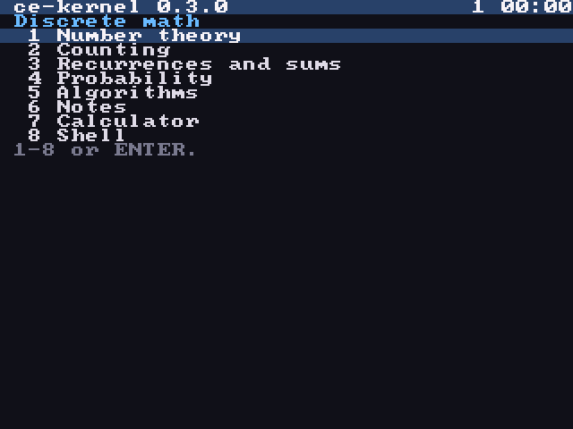
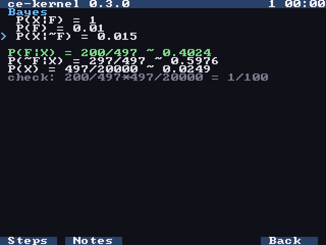
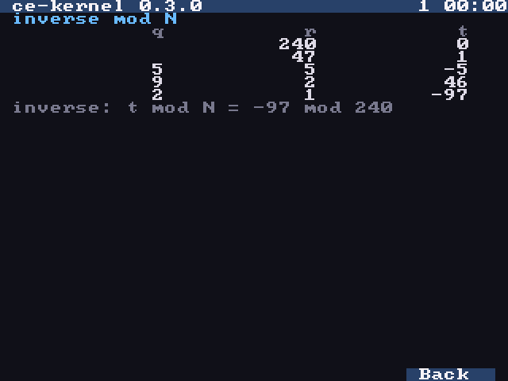
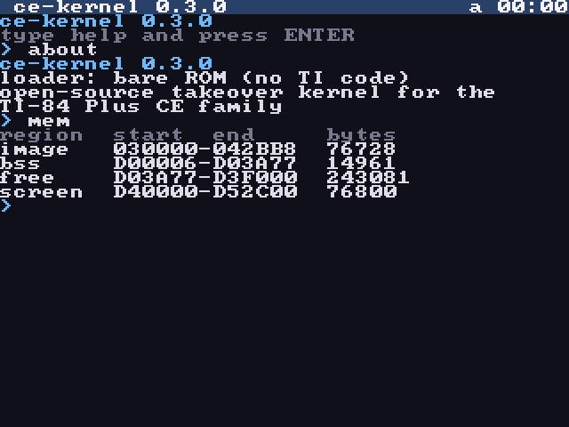

# ce-kernel

[](https://github.com/kadeski/ce-kernel/actions/workflows/ci.yml)

An open-source kernel for the TI-84 Plus CE family, including the Python Edition.

It boots into a menu of discrete math tools, with a notes viewer, an exact-fraction calculator and a shell, all on its own drivers for the screen, keypad and timers. Once it starts, no Texas Instruments code runs until you exit.

<p align="center">
  
  
  <br>
  
  
</p>

## Why a "takeover" kernel and not a replacement OS

TI's boot code only starts an operating system signed with TI's 2048-bit RSA key. The known ways around that (Cauldron, BootSwap) only work on hardware before revision M with boot code 5.3.6 or older. Every Python Edition is newer than that, so a flashed replacement OS can't be installed on it today.

So ce-kernel is built two ways from the same source:

| Build | File | Runs on | Started by |
|---|---|---|---|
| TI-OS loader | `bin/KERNEL.8xp` | your real calculator | TI-OS, as an assembly program (needs the arTIfiCE jailbreak on OS 5.5+) |
| Bare ROM | `bin/kernel.rom` | the CEmu emulator | the CPU's reset vector, with no TI code at all |

Both run the identical kernel. See [docs/DESIGN.md](docs/DESIGN.md) for the details.

## Highlights

- **No TI code, checked at link time.** The bare ROM links only the toolchain's pure C library and runtime, and `rom/check_no_os_calls.py` fails the build if any `call`, `jp` or `rst` lands in TI's boot code. A passing ROM build is the proof that the kernel needs nothing from TI.
- **Its own drivers.** The LCD controller (8bpp with a palette), keypad matrix, timer and real-time clock are driven through their registers, polled with interrupts off. Each driver saves the hardware state it changes and puts it back when the kernel exits to TI-OS.
- **Exact answers without floating point.** The toolchain's float routines call the boot code, so the tools and calculator work in reduced fractions of 64-bit integers, with every operation checked: an overflow is an error message, never a wrong answer. The expression evaluator uses static stacks instead of recursion to fit the TI-OS build's 4 KB of stack.
- **Tested by reading the screen.** `make smoke` boots the ROM in a headless CEmu, drives the menu, every tool and the shell with key presses, and reads each screenshot back as text by matching 8x8 cells against the kernel's own font. `make smoke-tios` does the same under real TI-OS, and checks that every way out returns to a working TI-OS.

## Build

Needs the [CE C toolchain](https://github.com/CE-Programming/toolchain) (v15.0 tested) with its `bin/` on your `PATH`, and Python 3.

```bash
make          # bin/KERNEL.8xp
make rom      # bin/kernel.rom
make smoke    # boots the ROM in headless CEmu, uses the menu, tools and shell, checks the output
```

`make smoke` needs `cemu-headless`; build it once with `tools/build-cemu-headless.sh`. `make smoke-tios` runs the same kind of test on `KERNEL.8xp` under TI-OS; it needs a ROM from your own calculator (see step 4 below).

To try it by hand, open `bin/kernel.rom` in [CEmu](https://github.com/CE-Programming/CEmu) (File, Open ROM image).

## Install on a calculator

`make smoke` only tests the bare ROM. The calculator build (`KERNEL.8xp`) uses a different loader and exit path, so test it in CEmu with a ROM from your own calculator before sending it to the real one.

Before you start, archive anything in RAM you care about. If the kernel ever hangs, the reset button on the back clears RAM.

1. Check the OS version: press `2nd`, `+` (MEM), then `1` (About). **Don't update the OS**: new versions patch the jailbreak (5.8.3 broke arTIfiCE v1, and v2 stops at 5.8.4), and downgrades are blocked. Decline the updates TI Connect CE offers.
2. Install the jailbreak. On OS 5.5 to 5.8.4, download `arTIfiCE_v2.1.8xp` from the [arTIfiCE releases](https://github.com/YvanTT/arTIfiCE/releases) (on 5.8.5 use v3 instead) and send it with TI Connect CE. To start it: `prgm`, choose TI-Basic if asked, pick the first program, `enter`.
3. Dump your ROM. In CEmu's setup screen choose "Create a ROM image from your calculator", save the dumper program, send it to the calculator and run it from arTIfiCE. It needs 65,793 bytes of free RAM and does nothing without them, so check RAM FREE under `2nd` `+` `2` first. Copy the `ROMData` variables it creates back to your computer and drop them into CEmu. The ROM and the `ROMData` files contain TI's code: keep them private and outside the repo (`.gitignore` only excludes `*.rom`).
4. Test in CEmu with that ROM:
   ```bash
   make smoke-tios TIOS_ROM=path/to/your.rom ARTIFICE=path/to/arTIfiCE_v2.1.8xp
   ```
   This sends arTIfiCE and `bin/KERNEL.8xp` to a headless CEmu, plus a small AppVar and a Python notes file to the archive (the dumped ROM's archive is empty) and a TI-Basic program `ZCLOCK` that sets the clock to 13:45 for the status bar to show. It starts the kernel from arTIfiCE, runs the tool, notes and shell checks, and then checks that `2nd` `mode` and `on` at the menu and `exit` in the shell each return to arTIfiCE's launcher, and that `mode` there quits to a home screen that still computes and runs programs. To try it by hand instead, open the ROM in CEmu, send both files and start the kernel from arTIfiCE.
5. Send `bin/KERNEL.8xp` to the calculator and start it from arTIfiCE's launcher. It is stored compressed (about 44 KB) and unpacks to about 84 KB of RAM when it starts, on top of the room the program itself takes, so archive what you can first. The first run on the calculator is the real test of how much it needs.
6. For the Notes entry, send your `*R.py` notes files (such as `NUMR.py`) to the archive.

Exam (Press-to-Test) mode deletes arTIfiCE; send it again afterwards.

## Using the kernel

The kernel starts on a menu: press a digit, or move with the arrows and press `enter`. The top-right corner shows `1` (digits) or `a` (letters), then the time from the calculator's clock in 24-hour format.

| Key | Does |
|---|---|
| `clear` | go back one screen (in a field with text, clear it first) |
| `2nd` `mode` | back to the menu; at the menu, exit to TI-OS |
| `on` | stop what is running and go back to the menu; at the menu, exit to TI-OS (the bare ROM ignores it there) |
| `alpha` | switch between letters and digits; `2nd` applies to the next key only |

### Study tools

The first five entries are sections of tools. A tool is a form: type a value in each field, move between fields with the up and down arrows, and press `enter` for the answer and a line that checks it or names the formula. Number fields take expressions, so `1/6`, `0.015` or `0.8^6*0.2^4` all work, and answers are exact fractions with a decimal (`200/497 ~ 0.4024`; `=` instead of `~` when the decimal is exact). The keys under the screen are labelled at the bottom: `y=` shows each step of the work, `window` opens the notes at the tool's heading, `graph` goes back.

| Section | Tools |
|---|---|
| Number theory | div and mod (rounding down), gcd and lcm with the remainders, inverse mod N with the extended Euclid tableau, power mod N, primes and factors, bases, RSA, ciphers and A=1 codes, LCG |
| Counting | nCr, nPr and n!, multisets with lower and upper bounds, multinomial, functions A to B (all, one-to-one, onto), pigeonhole, inclusion-exclusion for 2 or 3 sets, lex order (compare, next permutation), the counting decision tree |
| Recurrences and sums | iterate a recurrence in `a` = f(n-1), `b` = f(n-2) and `n` (the `x,t,θ,n` key types `n`), characteristic equation with the closed form, sums |
| Probability | Bayes, and/or/given, binomial, at least once (or how many tries to reach a target), expected value |
| Algorithms | bits and binary search, sort step counts, master theorem |

List fields take values separated by commas, such as `1,4,4,2`.

### Notes

Notes lists the archived Python files whose names end in `R`, such as `NUMR`, and shows one with its `# ` marks removed and headings highlighted. The up and down arrows scroll, left and right page.

### Calculator

The calculator evaluates one expression per line, such as `12*34` or `1-(9/10)^2`, using `+ - * / ^ ( )`, unary minus and decimals. It works in exact fractions, so `7/2` shows `7/2 = 3.5`, and `^` goes first and groups right to left (`2^3^2` is 512, `-2^2` is -4). `math` lists its functions and types the one you pick by its digit: `ncr(n,k)`, `npr(n,k)`, `fact(n)`, `gcd(a,b)`, `lcm(a,b)`, `div(x,n)`, `mod(x,n)` (never negative), `inv(x,n)` and `powmod(x,y,n)`. Numbers go up to 2^63-1, and anything bigger is an error rather than a wrong answer. `del`, `clear` and the up arrow edit the line as in the shell; `clear` on an empty line, `2nd` `mode` or `on` leave.

### Shell

The shell is the menu's last entry. It starts in alpha lock, so keys type the green letters printed above them. `enter` runs the line, `del` deletes the last character, `clear` clears the line and the up arrow recalls the last command. `on` stops the running command; at the prompt, `on` and `2nd` `mode` go back to the menu.

| Command | Does |
|---|---|
| `help` | list commands |
| `about` | version and how the kernel was started |
| `mem` | memory map: kernel image, variables, free RAM, screen |
| `uptime` | seconds since the kernel started |
| `keys` | live view of the key matrix (`clear` or `on` to stop) |
| `peek ADDR [LEN]` | hex dump of flash or RAM (hex numbers) |
| `ls` | list the variables in TI-OS's archive: type, name, size, where the data starts |
| `cat NAME` | hex dump of an archived variable's data (the first 128 bytes) |
| `calc` | the calculator above |
| `echo TEXT` | print text |
| `clear` | clear the screen |
| `exit` | return to TI-OS (the bare ROM halts instead) |

## Layout

```
src/drivers/   lcd, keypad, timer, real-time clock drivers and the hardware register map
src/kernel/    kmain, menu, ui (lists, forms, views), console, shell, calc, expressions,
               fractions and checked 64-bit math, notes viewer, archive reader, events,
               keymap, font
src/discrete/  the study tools, one file per section
src/tios/      TI-OS loader (KERNEL.8xp only)
rom/           bare ROM loader: reset code, cold hardware init, linker script
tests/         headless smoke test
tools/         helper scripts
```

## License

MIT, see [LICENSE](LICENSE). The font in `src/kernel/font8x8.c` is public domain (from [dhepper/font8x8](https://github.com/dhepper/font8x8)). Builds link the CE toolchain's C library and runtime, which are LGPL-3.0.
