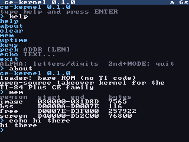

# ce-kernel

An open-source kernel for the TI-84 Plus CE family, including the Python Edition.

It boots into its own text console and shell, with its own drivers for the screen, keypad and timers. Once it starts, no Texas Instruments code runs until you exit.



## Why a "takeover" kernel and not a replacement OS

TI's boot code only starts an operating system signed with TI's 2048-bit RSA key. The known ways around that (Cauldron, BootSwap) only work on hardware before revision M with boot code 5.3.6 or older. Every Python Edition is newer than that, so a flashed replacement OS can't be installed on it today.

So ce-kernel is built two ways from the same source:

| Build | File | Runs on | Started by |
|---|---|---|---|
| TI-OS loader | `bin/KERNEL.8xp` | your real calculator | TI-OS, as an assembly program (needs the arTIfiCE jailbreak on OS 5.5+) |
| Bare ROM | `bin/kernel.rom` | the CEmu emulator | the CPU's reset vector, with no TI code at all |

Both run the identical kernel. See [docs/DESIGN.md](docs/DESIGN.md) for the details.

## Build

Needs the [CE C toolchain](https://github.com/CE-Programming/toolchain) (v15.0 tested) with its `bin/` on your `PATH`, and Python 3.

```bash
make          # bin/KERNEL.8xp
make rom      # bin/kernel.rom
make smoke    # boots the ROM in headless CEmu, types commands, checks the output
```

`make smoke` needs `cemu-headless`; build it once with `tools/build-cemu-headless.sh`. `make smoke-tios` runs the same kind of test on `KERNEL.8xp` under TI-OS; it needs a ROM from your own calculator (see step 4 below).

To try it by hand, open `bin/kernel.rom` in [CEmu](https://github.com/CE-Programming/CEmu) (File, Open ROM image).

## Install on a calculator

`make smoke` only tests the bare ROM. The calculator build (`KERNEL.8xp`) uses a different loader and exit path, so test it in CEmu with a ROM from your own calculator before sending it to the real one.

Before you start, archive anything in RAM you care about. If the kernel ever hangs, the reset button on the back clears RAM.

1. Check the OS version: press `2nd`, `+` (MEM), then `1` (About). **Don't update the OS**: new versions patch the jailbreak (5.8.3 broke arTIfiCE v1, and v2 stops at 5.8.4), and downgrades are blocked. Decline the updates TI Connect CE offers.
2. Install the jailbreak. On OS 5.5 to 5.8.4, download `arTIfiCE_v2.1.8xp` from the [arTIfiCE releases](https://github.com/YvanTT/arTIfiCE/releases) (on 5.8.5 use v3 instead) and send it with TI Connect CE. To start it: `prgm`, choose TI-Basic if asked, pick the first program, `enter`.
3. Dump your ROM. In CEmu's setup screen choose "Create a ROM image from your calculator", save the dumper program, send it to the calculator and run it from arTIfiCE. It needs 65,793 bytes of free RAM and does nothing without them, so check RAM FREE under `2nd` `+` `2` first. Copy the `ROMData` variables it creates back to the Mac and drop them into CEmu. The ROM and the `ROMData` files contain TI's code: keep them private and outside the repo (`.gitignore` only excludes `*.rom`).
4. Test in CEmu with that ROM:
   ```bash
   make smoke-tios TIOS_ROM=path/to/your.rom ARTIFICE=path/to/arTIfiCE_v2.1.8xp
   ```
   This sends arTIfiCE and `bin/KERNEL.8xp` to a headless CEmu, plus a small AppVar to the archive for `ls` and `cat` to find (the dumped ROM's archive is empty) and a TI-Basic program `ZCLOCK` that sets the clock to 13:45 for the status bar to show. It starts the kernel from arTIfiCE, runs the shell checks, and then checks that `exit`, `2nd` `mode` and `on` each return to arTIfiCE's launcher, and that `mode` there quits to a home screen that still computes and runs programs. To try it by hand instead, open the ROM in CEmu, send both files and start the kernel from arTIfiCE.
5. Send `bin/KERNEL.8xp` to the calculator and start it from arTIfiCE's launcher.

Exam (Press-to-Test) mode deletes arTIfiCE; send it again afterwards.

## Using the shell

The shell starts in alpha lock, so keys type the green letters printed above them. `alpha` toggles between letters and digits; `2nd` applies to the next key only. The top-right corner shows `a` (letters) or `1` (digits), then the time from the calculator's clock in 24-hour format.

| Key | Does |
|---|---|
| `enter` | run the line |
| `del` | delete the last character |
| `clear` | clear the line |
| up arrow | recall the last command |
| `2nd` `mode` | exit back to TI-OS (in `calc`, back to the shell) |
| `on` | stop the running command; at the prompt, exit back to TI-OS |

| Command | Does |
|---|---|
| `help` | list commands |
| `about` | version and how the kernel was started |
| `mem` | memory map: kernel image, variables, free RAM, screen |
| `uptime` | seconds since the kernel started |
| `keys` | live view of the key matrix (`clear` or `on` to stop) |
| `peek ADDR [LEN]` | hex dump of flash or RAM (hex numbers) |
| `ls` | list the variables in TI-OS's archive: type, name, size, where the data starts |
| `cat NAME` | hex dump of an archived variable's data (the first 128 bytes) |
| `calc` | integer calculator, one expression per line (see below) |
| `echo TEXT` | print text |
| `clear` | clear the screen |
| `exit` | return to TI-OS (the bare ROM halts instead) |

### Calculator

`calc` evaluates expressions such as `12*34` or `(2+3)^2`, one per line, using `+ - * / ^ ( )` and unary minus. It switches to digit mode, so no `alpha` is needed, and `del`, `clear` and the up arrow edit the line as at the shell prompt. `clear` on an empty line, `2nd` `mode` or `on` go back to the shell.

Numbers are whole and 32-bit, from -2147483648 to 2147483647, and a result outside that range is an error. `/` drops the remainder (`7/2` is 3), and `^` goes first and groups right to left, so `2^3^2` is 512 and `-2^2` is -4.

## Layout

```
src/drivers/   lcd, keypad, timer, real-time clock drivers and the hardware register map
src/kernel/    kmain, console, shell, calc, events, keymap, font
src/tios/      TI-OS loader (KERNEL.8xp only)
rom/           bare ROM loader: reset code, cold hardware init, linker script
tests/         headless smoke test
tools/         helper scripts
```

## License

MIT, see [LICENSE](LICENSE). The font in `src/kernel/font8x8.c` is public domain (from [dhepper/font8x8](https://github.com/dhepper/font8x8)). Builds link the CE toolchain's C library and runtime, which are LGPL-3.0.
